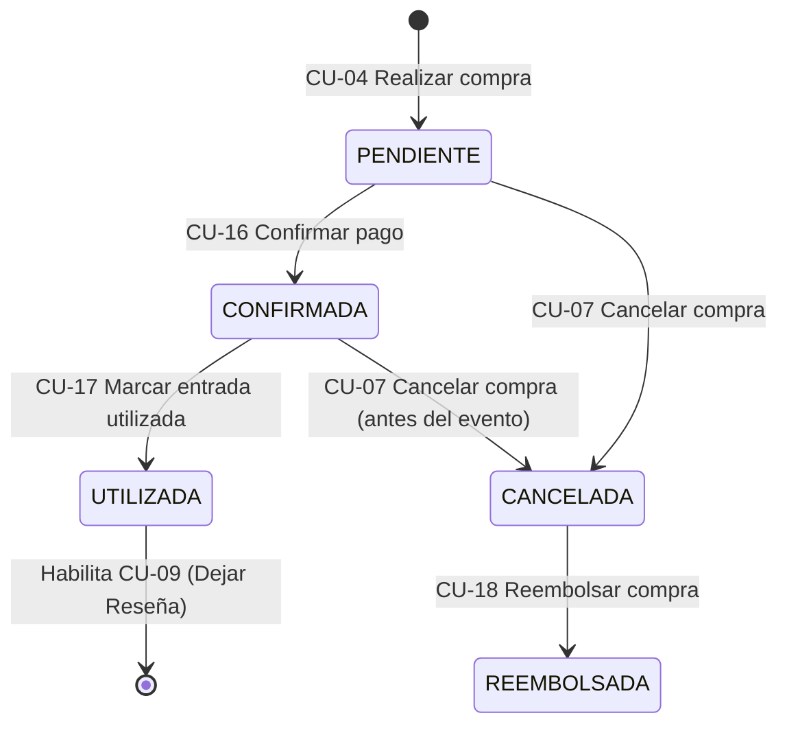

# Especificación de Casos de Uso - AI Ticket It

Documento de especificación detallada de los **26 Casos de Uso** del sistema **AI Ticket It**.

---

## Índice y Tabla Resumen

| ID | Caso de Uso | Actor Principal | Entidades Involucradas |
| :--- | :--- | :--- | :--- |
| **CU-01** | Buscar eventos por texto o categoría | Comprador | `Evento`, `Categoria` |
| **CU-02** | Ordenar eventos por precio, fecha y puntaje | Comprador | `Evento`, `TipoEntrada`, `Resenia`, `Usuario` |
| **CU-03** | Visualizar reseñas previas del organizador | Comprador | `Evento`, `Usuario`, `Resenia` |
| **CU-04** | Realizar compra de entradas | Comprador | `Compra`, `Evento`, `TipoEntrada`, `Usuario`, `CambioEstadoCompra` |
| **CU-05** | Visualizar mis compras y días faltantes | Comprador | `Compra`, `Evento`, `EstadoCompra` |
| **CU-06** | Enviar mensaje en el chat de una compra | Comprador | `Compra`, `Mensaje`, `Usuario` |
| **CU-07** | Cancelar compra para obtener reembolso | Comprador | `Compra`, `EstadoCompra`, `CambioEstadoCompra`, `TipoEntrada` |
| **CU-08** | Validar condiciones de cancelación de compra | Sistema / Organizador | `Compra`, `Evento`, `EstadoCompra` |
| **CU-09** | Puntuar y comentar un evento utilizado | Comprador | `Resenia`, `Compra`, `Evento`, `Usuario` |
| **CU-10** | Crear evento con tipos de entrada | Organizador | `Evento`, `TipoEntrada`, `Categoria`, `Usuario` |
| **CU-11** | Visualizar compras asociadas a un evento y cupos disponibles | Organizador | `Evento`, `Compra`, `TipoEntrada`, `EstadoCompra` |
| **CU-12** | Responder mensaje en el chat de una compra | Organizador | `Compra`, `Mensaje`, `Usuario` |
| **CU-13** | Agregar o quitar un evento de favoritos | Comprador | `Usuario`, `Evento` |
| **CU-14** | Filtrar eventos por rango de precios | Comprador | `Evento`, `TipoEntrada` |
| **CU-15** | Auditar cambio de estado de una compra | Sistema | `Compra`, `EstadoCompra`, `CambioEstadoCompra`, `Usuario` |
| **CU-16** | Confirmar pago de una compra | Comprador / Organizador | `Compra`, `EstadoCompra`, `CambioEstadoCompra` |
| **CU-17** | Marcar entrada como utilizada | Organizador | `Compra`, `EstadoCompra`, `CambioEstadoCompra` |
| **CU-18** | Registrar reembolso de compra cancelada | Organizador / Sistema | `Compra`, `EstadoCompra`, `CambioEstadoCompra` |
| **CU-19** | Consultar historial de estados de una compra | Comprador / Organizador | `Compra`, `CambioEstadoCompra` |
| **CU-20** | Visualizar detalle completo de un evento | Comprador / Organizador | `Evento`, `Categoria`, `TipoEntrada`, `Usuario`, `Resenia` |
| **CU-21** | Listar mis eventos organizados | Organizador | `Evento`, `Usuario` |
| **CU-22** | Editar datos de un evento | Organizador | `Evento`, `TipoEntrada`, `Categoria` |
| **CU-23** | Visualizar mi lista de eventos favoritos | Comprador | `Usuario`, `Evento` |
| **CU-24** | Consultar historial de mensajes del chat de una compra | Comprador / Organizador | `Compra`, `Mensaje`, `Usuario` |
| **CU-25** | Listar categorías disponibles | Comprador / Organizador | `Categoria` |
| **CU-26** | Seleccionar o cambiar usuario/rol activo | Usuario | `Usuario` |

---

## Ciclo de Vida de Estados de la Compra (`EstadoCompra`)

---

## Especificación Detallada de Casos de Uso

### CU-01: Buscar eventos por texto o categoría
* **Actor Principal:** Comprador.
* **Objetivo:** Permitir al comprador encontrar eventos específicos mediante texto libre o explorando por categoría.
* **Precondiciones:**
  * El comprador se encuentra en la pantalla de catálogo/exploración de eventos.
* **Postcondiciones:**
  * Se presenta en pantalla el listado de eventos que coinciden con los criterios de búsqueda.
* **Flujo Principal (Curso Normal):**
  1. El comprador ingresa un término de búsqueda en la barra de búsqueda y/o selecciona una `Categoria`.
  2. El sistema consulta los eventos registrados en memoria.
  3. El sistema filtra aquellos eventos cuyo `nombre` o `descripcion` contengan el texto buscado (sin distinción de mayúsculas/minúsculas) y que pertenezcan a la `categoria` seleccionada.
  4. El sistema devuelve y muestra la lista de eventos resultantes con su información resumida (nombre, fecha, categoría, precio desde y organizador).
* **Flujos Alternativos:**
  * **3a. Sin coincidencias:** Si ningún evento cumple los criterios, el sistema muestra un mensaje informando que no se encontraron eventos para esa búsqueda.
  * **1a. Sin filtros aplicados:** Si el comprador limpia la búsqueda y la categoría, el sistema muestra todos los eventos vigentes del catálogo.

---

### CU-02: Ordenar eventos por precio, fecha y puntaje del organizador
* **Actor Principal:** Comprador.
* **Objetivo:** Ordenar el listado de eventos buscados o explorados según el criterio elegido por el comprador.
* **Precondiciones:**
  * Existe un listado de eventos cargado en el catálogo o resultado de una búsqueda (**CU-01**).
* **Postcondiciones:**
  * El listado de eventos se visualiza reordenado bajo el criterio y sentido seleccionados.
* **Flujo Principal (Curso Normal):**
  1. El comprador selecciona la opción de ordenamiento indicando uno de los criterios disponibles: **Precio**, **Fecha del evento** o **Puntaje del organizador**.
  2. El sistema procesa la lista de eventos aplicando el criterio elegido:
     * **Por precio:** Calcula el menor `precio` entre los `tiposEntrada` de cada evento y los ordena de menor a mayor (o mayor a menor).
     * **Por fecha del evento:** Ordena cronológicamente según el atributo `fecha` de cada `Evento`.
     * **Por puntaje del organizador:** Calcula el promedio de `puntuacion` de todas las `Resenia` asociadas a los eventos del `organizador` de cada evento y ordena de mayor a menor reputación.
  3. El sistema actualiza la vista mostrando los eventos en el nuevo orden.
* **Flujos Alternativos:**
  * **2a. Organizador sin reseñas previas:** Si un organizador aún no posee reseñas, se le asigna un puntaje neutro/cero (`0`) ubicándolo al final del ordenamiento por puntaje.

---

### CU-03: Visualizar reseñas previas del organizador
* **Actor Principal:** Comprador.
* **Objetivo:** Conocer las experiencias previas de otros compradores en eventos anteriores del mismo organizador antes de realizar una compra.
* **Precondiciones:**
  * El comprador accede a la vista de un `Evento` (**CU-20**).
* **Postcondiciones:**
  * Se muestran en pantalla el puntaje promedio del organizador y las reseñas históricas asociadas a sus eventos.
* **Flujo Principal (Curso Normal):**
  1. El comprador selecciona un `Evento` del catálogo.
  2. El sistema identifica al `Usuario` que actúa como `organizador` de dicho evento.
  3. El sistema busca todas las instancias de `Resenia` vinculadas a cualquier `Evento` perteneciente a ese `organizador`.
  4. El sistema calcula el promedio de `puntuacion` del organizador.
  5. El sistema muestra dentro de la pantalla del evento la reputación del organizador y el listado de reseñas (nombre del `comprador`, nombre del `evento` reseñado, `puntuacion` numérica y comentario `detalle`).
* **Flujos Alternativos:**
  * **3a. Organizador sin reseñas:** Si el organizador no tiene reseñas en eventos anteriores, el sistema muestra el mensaje *"Este organizador aún no tiene reseñas previas"*.

---

### CU-04: Realizar compra de entradas
* **Actor Principal:** Comprador.
* **Objetivo:** Adquirir una cantidad determinada de entradas de un tipo específico para un evento, sin superar el cupo disponible.
* **Precondiciones:**
  * El comprador ha seleccionado un `Evento` vigente (cuya `fecha` sea posterior a la fecha actual).
  * El evento cuenta con al menos un `TipoEntrada` configurado.
* **Postcondiciones:**
  * Se crea una nueva instancia de `Compra` asociada al comprador, al evento y al tipo de entrada.
  * Se descuenta la `cantidad` comprada del `cupo` del `TipoEntrada` seleccionado.
  * Se registra el estado inicial de la compra en el historial `CambioEstadoCompra` (**CU-15**).
* **Flujo Principal (Curso Normal):**
  1. En el detalle del evento, el comprador selecciona un `TipoEntrada` disponible (ej. General, Platea, VIP).
  2. El comprador ingresa la `cantidad` de entradas que desea adquirir (entero mayor a 0) y confirma la operación.
  3. El sistema invoca `tipoEntrada.hayCupoPara(cantidad)` para verificar que `cantidad <= tipoEntrada.cupo`.
  4. El sistema descuenta el cupo disponible (`tipoEntrada.cupo -= cantidad`).
  5. El sistema calcula el monto `total` (`tipoEntrada.precio * cantidad`).
  6. El sistema instancia la `Compra` con `comprador`, `evento`, `tipoEntrada`, `cantidad`, `total`, `estado = EstadoCompra.PENDIENTE` (o `CONFIRMADA` si se confirma en el acto) y lista de `mensajes` vacía.
  7. El sistema registra la auditoría en `CambioEstadoCompra` (**CU-15**).
  8. El sistema informa al comprador que la compra fue creada exitosamente y redirige al detalle de la compra o a "Mis Compras".
* **Flujos Alternativos / Excepciones:**
  * **3a. Cupo insuficiente (`hayCupoPara(cantidad) == false`):** El sistema rechaza la operación y muestra un mensaje indicando que la cantidad solicitada supera el cupo disponible actual (`tipoEntrada.cupo`).
  * **2a. Cantidad inválida:** Si la cantidad es menor o igual a 0, el sistema solicita ingresar una cantidad válida.
  * **1a. Evento ya finalizado:** Si la fecha del evento ya pasó, el sistema impide iniciar la compra.

---

### CU-05: Visualizar mis compras y días faltantes
* **Actor Principal:** Comprador.
* **Objetivo:** Consultar todas las compras realizadas por el comprador, identificando claramente su estado actual y cuántos días faltan para el evento si la compra está confirmada.
* **Precondiciones:**
  * El comprador se encuentra identificado en la aplicación.
* **Postcondiciones:**
  * Se muestra el listado de compras del usuario con sus estados diferenciados y el cálculo de días restantes cuando corresponda.
* **Flujo Principal (Curso Normal):**
  1. El comprador navega a la sección "Mis Compras".
  2. El sistema recupera todas las instancias de `Compra` cuyo `comprador` coincida con el usuario activo.
  3. Para cada compra, el sistema obtiene los datos del `evento`, `tipoEntrada`, `cantidad`, `total` y `estado`.
  4. Si `compra.estado == EstadoCompra.CONFIRMADA`:
     * El sistema calcula la diferencia en días entre `evento.fecha` y la fecha actual (`diasFaltantes = ceil((evento.fecha - ahora) / 1 día)`).
  5. El sistema renderiza cada compra con un indicador visual claro de su estado (`PENDIENTE`, `CONFIRMADA`, `UTILIZADA`, `CANCELADA`, `REEMBOLSADA`) y, para las confirmadas, muestra la leyenda con los días que faltan para el evento.
* **Flujos Alternativos:**
  * **2a. Sin compras registradas:** Si el comprador aún no realizó compras, se muestra un estado vacío invitándolo a explorar el catálogo de eventos.
  * **4a. Evento en el día de hoy:** Si la compra está `CONFIRMADA` y el evento ocurre hoy (`diasFaltantes == 0`), el sistema muestra *"¡Es hoy!"*.

---

### CU-06: Enviar mensaje en el chat de una compra
* **Actor Principal:** Comprador.
* **Objetivo:** Enviar consultas al organizador en cualquier momento dentro del espacio de comunicación de una compra.
* **Precondiciones:**
  * Existe una `Compra` perteneciente al comprador.
* **Postcondiciones:**
  * Se crea un nuevo objeto `Mensaje` y se agrega a la colección `mensajes` de la `Compra`.
* **Flujo Principal (Curso Normal):**
  1. El comprador accede al detalle/chat de una de sus compras (**CU-24**).
  2. El comprador escribe un texto en el campo de mensaje y presiona "Enviar".
  3. El sistema valida que el texto del mensaje no esté vacío y que el usuario sea el `comprador` de dicha `Compra`.
  4. El sistema crea una instancia de `Mensaje` con `usuario = comprador`, `mensaje = texto` y `enviado = fechaHoraActual`.
  5. El sistema agrega el `Mensaje` a `compra.mensajes` y actualiza la vista del chat.
* **Flujos Alternativos:**
  * **3a. Mensaje vacío:** Si el texto contiene solo espacios en blanco, el sistema deshabilita el envío o informa que el mensaje no puede estar vacío.

---

### CU-07: Cancelar una compra para obtener reembolso
* **Actor Principal:** Comprador.
* **Objetivo:** Cancelar una compra vigente cuando el comprador no pueda asistir al evento, obteniendo el reembolso correspondiente y liberando las entradas.
* **Precondiciones:**
  * La `Compra` pertenece al comprador activo.
* **Postcondiciones:**
  * El estado de la compra se actualiza a `CANCELADA` / `REEMBOLSADA`.
  * Se restituye la `cantidad` de entradas al `cupo` del `TipoEntrada` del evento.
  * Se registra la trazabilidad en `CambioEstadoCompra`.
* **Flujo Principal (Curso Normal):**
  1. Desde "Mis Compras" o el detalle de una compra, el comprador selecciona la acción "Cancelar compra".
  2. El sistema solicita confirmación al comprador.
  3. El comprador confirma la cancelación.
  4. El sistema ejecuta las validaciones de reglas de negocio de cancelación (**CU-08**).
  5. El sistema invoca `compra.actualizarEstado(EstadoCompra.CANCELADA)` (y transiciona a `REEMBOLSADA` según el flujo de reembolso **CU-18**) registrando el `CambioEstadoCompra` (**CU-15**).
  6. El sistema incrementa el cupo disponible del tipo de entrada (`compra.tipoEntrada.cupo += compra.cantidad`).
  7. El sistema notifica al comprador que la compra fue cancelada y reembolsada con éxito.
* **Flujos Alternativos / Excepciones:**
  * **4a. Validación rechazada (CU-08):** Si la compra está en estado `UTILIZADA`, ya estaba `CANCELADA`/`REEMBOLSADA`, o el evento ya ocurrió, el sistema bloquea la acción y muestra un mensaje explicativo.

---

### CU-08: Validar condiciones de cancelación de compra
* **Actor Principal:** Sistema (Regla de negocio requerida por el Organizador).
* **Objetivo:** Garantizar que una compra solo pueda cancelarse si no fue utilizada y si el evento aún no se ha realizado.
* **Precondiciones:**
  * Se invoca una solicitud de cancelación sobre una `Compra` (**CU-07**).
* **Postcondiciones:**
  * Se autoriza o se deniega la cancelación de la compra.
* **Flujo Principal (Curso Normal):**
  1. El sistema recibe la `Compra` que se desea cancelar.
  2. El sistema verifica que `compra.estado != EstadoCompra.UTILIZADA`.
  3. El sistema verifica que la compra no haya sido cancelada o reembolsada previamente (`compra.estado != CANCELADA` y `compra.estado != REEMBOLSADA`).
  4. El sistema verifica que la fecha del evento sea futura (`compra.evento.fecha > fechaHoraActual`).
  5. Todas las validaciones resultan verdaderas y el sistema autoriza continuar con el **CU-07**.
* **Flujos Alternativos / Excepciones:**
  * **2a. Entrada ya utilizada:** Si `compra.estado == EstadoCompra.UTILIZADA`, el sistema lanza un error de negocio: *"No se puede cancelar una compra cuya entrada ya fue utilizada"*.
  * **4a. Evento ya realizado:** Si `compra.evento.fecha <= fechaHoraActual`, el sistema lanza un error de negocio: *"No se puede cancelar la compra porque el evento ya se ha realizado"*.

---

### CU-09: Puntuar y comentar un evento utilizado
* **Actor Principal:** Comprador.
* **Objetivo:** Calificar numéricamente y dejar un comentario escrito sobre el evento una vez que la entrada haya sido utilizada.
* **Precondiciones:**
  * El comprador tiene una `Compra` asociada al `Evento` cuyo estado es `EstadoCompra.UTILIZADA`.
* **Postcondiciones:**
  * Se crea una nueva instancia de `Resenia` vinculada al `comprador` y al `evento`.
  * Se actualiza el puntaje promedio del organizador para futuras consultas (**CU-02**, **CU-03**).
* **Flujo Principal (Curso Normal):**
  1. En una compra con estado `UTILIZADA`, el comprador selecciona la opción "Calificar Evento / Dejar Reseña".
  2. El comprador ingresa una `puntuacion` numérica (por ejemplo, de 1 a 5 estrellas) y redacta un comentario en `detalle`.
  3. El sistema valida que la compra del usuario para ese evento se encuentre efectivamente en estado `UTILIZADA`.
  4. El sistema valida que la `puntuacion` esté dentro del rango permitido (1 a 5) y que `detalle` no esté vacío.
  5. El sistema crea la instancia de `Resenia` con `comprador`, `evento`, `detalle` y `puntuacion`.
  6. El sistema guarda la reseña en memoria y confirma la publicación al comprador.
* **Flujos Alternativos / Excepciones:**
  * **3a. Entrada no utilizada:** Si el estado de la compra es distinto de `UTILIZADA` (ej. `PENDIENTE`, `CONFIRMADA`, `CANCELADA`), el sistema impide crear la reseña e informa que solo se pueden reseñar eventos cuya entrada haya sido utilizada.
  * **3b. Reseña duplicada:** Si el comprador ya dejó una reseña para ese evento/compra, el sistema informa que ya fue calificado.

---

### CU-10: Crear evento con tipos de entrada
* **Actor Principal:** Organizador.
* **Objetivo:** Publicar un nuevo evento en la plataforma definiendo sus datos descriptivos, multimedia y los distintos tipos de entrada con su respectivo precio y cupo.
* **Precondiciones:**
  * El usuario activo opera bajo el rol de Organizador.
  * Existen categorías cargadas en el sistema (**CU-25**).
* **Postcondiciones:**
  * Se crea en memoria una nueva instancia de `Evento` con sus objetos `TipoEntrada` asociados y el `Usuario` actual asignado como `organizador`.
* **Flujo Principal (Curso Normal):**
  1. El organizador accede al formulario de "Crear Evento".
  2. El organizador ingresa los datos generales del evento: `nombre`, `descripcion`, selecciona una `Categoria`, define la `fecha` y hora de realización, y agrega URLs/recursos en `multimedia`.
  3. El organizador agrega uno o más tipos de entrada (`TipoEntrada`), indicando para cada uno: `nombre` (ej. General, Platea, VIP), `descripcion`, `precio` ($\ge 0$) y `cupo` ($> 0$).
  4. El organizador confirma la creación del evento.
  5. El sistema valida que todos los campos obligatorios estén completos, que la `fecha` sea futura y que exista al menos un `TipoEntrada` válido.
  6. El sistema instancia los objetos `TipoEntrada` y el objeto `Evento` asignando `organizador = usuarioActual`.
  7. El sistema almacena el evento en memoria y lo deja disponible en el catálogo general.
* **Flujos Alternativos / Excepciones:**
  * **5a. Sin tipos de entrada:** Si el organizador intenta crear el evento sin ningún `TipoEntrada`, el sistema muestra un error solicitando al menos un tipo de entrada.
  * **5b. Precio o cupo inválido:** Si algún tipo de entrada tiene precio negativo o cupo menor o igual a cero, el sistema solicita corregir los valores.

---

### CU-11: Visualizar compras asociadas a un evento y cupos disponibles
* **Actor Principal:** Organizador.
* **Objetivo:** Monitorear las ventas de un evento propio, identificando el estado de cada compra y la cantidad de entradas disponibles remanentes por cada tipo de entrada.
* **Precondiciones:**
  * El usuario activo es el `organizador` del `Evento` a consultar.
* **Postcondiciones:**
  * Se visualiza el panel del evento con el desglose de cupos disponibles por `TipoEntrada` y el listado de compras discriminadas por `EstadoCompra`.
* **Flujo Principal (Curso Normal):**
  1. El organizador selecciona uno de sus eventos desde "Mis Eventos Organizados" (**CU-21**).
  2. El sistema recupera el `Evento` y su lista de `tiposEntrada`, mostrando para cada tipo: nombre, precio y `cupo` disponible actual.
  3. El sistema recupera todas las instancias de `Compra` asociadas a ese `Evento`.
  4. El sistema presenta el listado de compras indicando: nombre y apellido del `comprador`, `tipoEntrada` adquirido, `cantidad`, monto `total`, `estado` actual claramente diferenciado y acceso al chat de esa compra.
* **Flujos Alternativos:**
  * **3a. Evento sin compras aún:** Si todavía no se registraron compras para el evento, el sistema muestra los cupos intactos de cada tipo de entrada y el mensaje *"Aún no hay compras registradas para este evento"*.

---

### CU-12: Responder mensaje en el chat de una compra
* **Actor Principal:** Organizador.
* **Objetivo:** Responder consultas de un comprador en cualquier momento a través del chat integrado en la compra.
* **Precondiciones:**
  * Existe una `Compra` asociada a un `Evento` cuyo `organizador` es el usuario activo.
* **Postcondiciones:**
  * Se crea una nueva instancia de `Mensaje` con el organizador como autor y se añade a `compra.mensajes`.
* **Flujo Principal (Curso Normal):**
  1. Desde la lista de compras de su evento (**CU-11**), el organizador selecciona una `Compra` y abre su chat (**CU-24**).
  2. El organizador escribe su respuesta y presiona "Enviar".
  3. El sistema verifica que el usuario activo sea el `organizador` del `evento` de esa compra y que el texto no esté vacío.
  4. El sistema instancia el `Mensaje` con `usuario = organizador`, `mensaje = texto` y `enviado = fechaHoraActual`.
  5. El sistema agrega el mensaje a `compra.mensajes` y actualiza la conversación en pantalla.
* **Flujos Alternativos / Excepciones:**
  * **3a. Usuario no autorizado:** Si el usuario no es ni el comprador de la compra ni el organizador del evento, el sistema rechaza el envío.

---

### CU-13: Agregar o quitar un evento de favoritos
* **Actor Principal:** Comprador.
* **Objetivo:** Guardar eventos de interés en la lista personal de favoritos del usuario o quitarlos de ella.
* **Precondiciones:**
  * El comprador está visualizando el catálogo de eventos o el detalle de un `Evento`.
* **Postcondiciones:**
  * El `Evento` es añadido o eliminado de la colección `favoritos: Evento[]` del `Usuario`.
* **Flujo Principal (Curso Normal):**
  1. El comprador presiona el ícono de "Favorito" sobre un `Evento`.
  2. El sistema verifica si el `Evento` ya se encuentra en `usuario.favoritos`.
  3. Si **no** se encuentra en la lista, el sistema agrega el `Evento` a `usuario.favoritos`.
  4. El sistema actualiza el estado visual del ícono de favorito.
* **Flujos Alternativos:**
  * **3a. El evento ya era favorito:** Si el `Evento` ya estaba en `usuario.favoritos`, el sistema lo remueve de la lista y actualiza el indicador visual.

---

### CU-14: Filtrar eventos por rango de precios
* **Actor Principal:** Comprador.
* **Objetivo:** Filtrar el catálogo de eventos para mostrar únicamente aquellos que ofrezcan entradas dentro de un rango de precio mínimo y máximo.
* **Precondiciones:**
  * El comprador se encuentra en el buscador/catálogo de eventos.
* **Postcondiciones:**
  * Se listan únicamente los eventos en los que `evento.tuPrecioEstaEntre(min, max)` devuelve `true`.
* **Flujo Principal (Curso Normal):**
  1. El comprador ingresa un precio mínimo (`min`) y un precio máximo (`max`) en los filtros de búsqueda.
  2. El sistema evalúa sobre cada evento el método de dominio `evento.tuPrecioEstaEntre(min, max)`.
  3. Dicho método retorna `true` si el evento posee al menos un `TipoEntrada` cuyo `precio >= min` y `precio <= max`.
  4. El sistema devuelve y muestra en pantalla los eventos que cumplieron la condición.
* **Flujos Alternativos / Excepciones:**
  * **1a. Rango inválido (`min > max`):** Si el valor mínimo supera al máximo, el sistema informa al comprador que el rango ingresado no es válido.

---

### CU-15: Auditar cambio de estado de una compra
* **Actor Principal:** Sistema.
* **Objetivo:** Mantener la trazabilidad completa de cada transición de estado que atraviesa una compra.
* **Precondiciones:**
  * Se ejecuta un cambio de estado en una `Compra` (creación, confirmación, utilización, cancelación o reembolso).
* **Postcondiciones:**
  * El atributo `compra.estado` queda actualizado mediante `compra.actualizarEstado(nuevoEstado)`.
  * Se almacena un nuevo registro `CambioEstadoCompra` asociado a la compra.
* **Flujo Principal (Curso Normal):**
  1. Un caso de uso (**CU-04**, **CU-07**, **CU-16**, **CU-17** o **CU-18**) solicita cambiar el estado de una `Compra` indicando el nuevo `EstadoCompra` y el `Usuario` ejecutor (`quien`).
  2. El sistema ejecuta `compra.actualizarEstado(nuevoEstado)`.
  3. El sistema crea una instancia de `CambioEstadoCompra` con:
     * `compra`: referencia a la compra modificada.
     * `estado`: el nuevo `EstadoCompra`.
     * `quien`: el `Usuario` que disparó el cambio.
     * `fechaHora`: fecha y hora exacta de la transición.
  4. El sistema persiste en memoria el registro de auditoría.

---

### CU-16: Confirmar pago de una compra (`PENDIENTE` $\rightarrow$ `CONFIRMADA`)
* **Actor Principal:** Comprador / Organizador.
* **Objetivo:** Acreditar el pago de una compra que se encontraba pendiente, pasándola al estado `CONFIRMADA`.
* **Precondiciones:**
  * La `Compra` se encuentra en estado `EstadoCompra.PENDIENTE`.
* **Postcondiciones:**
  * La `Compra` pasa al estado `EstadoCompra.CONFIRMADA` y se registra el `CambioEstadoCompra` (**CU-15**).
  * Se habilita el cálculo de días restantes para el evento en "Mis Compras" (**CU-05**).
* **Flujo Principal (Curso Normal):**
  1. El actor selecciona la opción "Confirmar Pago / Confirmar Compra" sobre una compra en estado `PENDIENTE`.
  2. El sistema valida que `compra.estado == EstadoCompra.PENDIENTE`.
  3. El sistema actualiza el estado a `EstadoCompra.CONFIRMADA` e invoca la auditoría (**CU-15**).
  4. El sistema muestra la compra como `CONFIRMADA` junto con los días que faltan para la realización del evento.
* **Flujos Alternativos / Excepciones:**
  * **2a. Estado incompatible:** Si la compra no está `PENDIENTE`, el sistema rechaza la transición.

---

### CU-17: Marcar entrada como utilizada (`CONFIRMADA` $\rightarrow$ `UTILIZADA`)
* **Actor Principal:** Organizador.
* **Objetivo:** Registrar el ingreso o asistencia del comprador al evento, cambiando el estado de la compra a `UTILIZADA`.
* **Precondiciones:**
  * El usuario activo es el `organizador` del evento.
  * La `Compra` se encuentra en estado `EstadoCompra.CONFIRMADA`.
* **Postcondiciones:**
  * La `Compra` pasa a `EstadoCompra.UTILIZADA` y se audita el cambio (**CU-15**).
  * Queda bloqueada la posibilidad de cancelar la compra (**CU-08**).
  * Queda habilitada la posibilidad de que el comprador puntúe y comente el evento (**CU-09**).
* **Flujo Principal (Curso Normal):**
  1. Desde el panel de compras del evento (**CU-11**), el organizador localiza una compra con estado `CONFIRMADA`.
  2. El organizador selecciona la acción "Marcar como Utilizada / Acreditar ingreso".
  3. El sistema valida que `compra.estado == EstadoCompra.CONFIRMADA`.
  4. El sistema actualiza el estado a `EstadoCompra.UTILIZADA` y registra el `CambioEstadoCompra` (**CU-15**).
  5. El sistema actualiza la vista del organizador y del comprador.
* **Flujos Alternativos / Excepciones:**
  * **3a. Compra no confirmada o cancelada:** Si la compra está `PENDIENTE`, `CANCELADA` o `REEMBOLSADA`, el sistema no permite marcarla como utilizada.

---

### CU-18: Registrar reembolso de compra cancelada (`CANCELADA` $\rightarrow$ `REEMBOLSADA`)
* **Actor Principal:** Organizador / Sistema.
* **Objetivo:** Reflejar que el importe de una compra cancelada ha sido reembolsado al comprador.
* **Precondiciones:**
  * La `Compra` se encuentra en estado `EstadoCompra.CANCELADA`.
* **Postcondiciones:**
  * La `Compra` pasa al estado `EstadoCompra.REEMBOLSADA` y se registra el `CambioEstadoCompra` (**CU-15**).
* **Flujo Principal (Curso Normal):**
  1. Una vez cancelada la compra (**CU-07**) o por acción explícita del organizador sobre una compra `CANCELADA`, se ejecuta la acción de reembolso.
  2. El sistema verifica que `compra.estado == EstadoCompra.CANCELADA`.
  3. El sistema actualiza el estado a `EstadoCompra.REEMBOLSADA` y registra la auditoría en `CambioEstadoCompra` (**CU-15**).
  4. El sistema muestra el estado final `REEMBOLSADA` en los paneles del comprador y del organizador.

---

### CU-19: Consultar historial de estados de una compra
* **Actor Principal:** Comprador / Organizador.
* **Objetivo:** Visualizar la trazabilidad completa de todos los estados por los que pasó una compra desde su creación.
* **Precondiciones:**
  * El usuario es el `comprador` de la compra o el `organizador` del evento asociado.
* **Postcondiciones:**
  * Se muestra en orden cronológico la lista de `CambioEstadoCompra` de esa compra.
* **Flujo Principal (Curso Normal):**
  1. El usuario accede al detalle de una `Compra`.
  2. El sistema recupera todos los registros de `CambioEstadoCompra` vinculados a esa `Compra` ordenados por `fechaHora`.
  3. El sistema muestra cada hito indicando el `estado` alcanzado, el nombre y apellido de `quien` lo ejecutó y la `fechaHora`.

---

### CU-20: Visualizar detalle completo de un evento
* **Actor Principal:** Comprador / Organizador.
* **Objetivo:** Consultar toda la información descriptiva, multimedia, tipos de entrada, cupos y reseñas del organizador de un evento específico.
* **Precondiciones:**
  * El `Evento` existe en el sistema.
* **Postcondiciones:**
  * Se presenta en pantalla la ficha completa del evento.
* **Flujo Principal (Curso Normal):**
  1. El usuario selecciona un `Evento` desde el catálogo, favoritos o "Mis Eventos".
  2. El sistema recupera la entidad `Evento` con su `Categoria`, su `organizador`, su lista de `multimedia` y sus `tiposEntrada`.
  3. El sistema obtiene además las reseñas históricas de los eventos del organizador (**CU-03**).
  4. El sistema muestra en pantalla:
     * Nombre, descripción detallada, categoría, fecha/hora e imágenes/multimedia.
     * Nombre del organizador y su puntaje promedio.
     * Lista de `TipoEntrada` con su nombre, descripción, precio y cupo disponible.
     * Selector para realizar la compra (**CU-04**) y sección de reseñas previas del organizador (**CU-03**).

---

### CU-21: Listar mis eventos organizados
* **Actor Principal:** Organizador.
* **Objetivo:** Visualizar todos los eventos creados por el organizador actual para gestionar su información y sus ventas.
* **Precondiciones:**
  * El usuario activo opera en la vista de Organizador.
* **Postcondiciones:**
  * Se muestra la lista de eventos cuyo `organizador` es el usuario activo.
* **Flujo Principal (Curso Normal):**
  1. El organizador ingresa a la sección "Mis Eventos".
  2. El sistema filtra los eventos en memoria donde `evento.organizador.id == usuarioActual.id`.
  3. El sistema muestra cada evento con su fecha, categoría, total de entradas disponibles/vendidas y acceso directo a ver sus compras asociadas (**CU-11**) o editarlo (**CU-22**).
* **Flujos Alternativos:**
  * **2a. Sin eventos creados:** Si el organizador no ha publicado eventos aún, se muestra un botón destacado para "Crear mi primer Evento" (**CU-10**).

---

### CU-22: Editar datos de un evento
* **Actor Principal:** Organizador.
* **Objetivo:** Actualizar la información de un evento propio (como cambios de fecha, descripción o material multimedia).
* **Precondiciones:**
  * El usuario activo es el `organizador` del `Evento`.
* **Postcondiciones:**
  * Los datos del `Evento` quedan actualizados en memoria.
* **Flujo Principal (Curso Normal):**
  1. Desde "Mis Eventos" (**CU-21**), el organizador selecciona la opción "Editar Evento".
  2. El sistema precarga el formulario con los datos actuales del evento (`nombre`, `descripcion`, `categoria`, `fecha`, `multimedia`).
  3. El organizador modifica los campos necesarios (por ejemplo, reprograma la `fecha` de realización) y guarda los cambios.
  4. El sistema valida los datos ingresados y actualiza la instancia del `Evento` en memoria.
  5. El sistema confirma la actualización y muestra el detalle actualizado del evento.

---

### CU-23: Visualizar mi lista de eventos favoritos
* **Actor Principal:** Comprador.
* **Objetivo:** Consultar rápidamente todos los eventos que el comprador guardó como favoritos.
* **Precondiciones:**
  * El comprador se encuentra identificado en la aplicación.
* **Postcondiciones:**
  * Se muestra el listado de eventos contenidos en `usuario.favoritos`.
* **Flujo Principal (Curso Normal):**
  1. El comprador accede a la sección "Mis Favoritos".
  2. El sistema consulta la colección `favoritos: Evento[]` del `Usuario` activo.
  3. El sistema renderiza la lista de eventos favoritos permitiendo entrar al detalle de cualquiera de ellos (**CU-20**) o quitarlo de favoritos (**CU-13**).
* **Flujos Alternativos:**
  * **2a. Lista de favoritos vacía:** Si `usuario.favoritos` no tiene elementos, el sistema muestra un mensaje indicando que aún no tiene eventos guardados en favoritos.

---

### CU-24: Consultar historial de mensajes del chat de una compra
* **Actor Principal:** Comprador / Organizador.
* **Objetivo:** Leer todos los mensajes intercambiados entre el comprador y el organizador respecto a una compra específica.
* **Precondiciones:**
  * El usuario activo es el `comprador` de la `Compra` o el `organizador` del `Evento` asociado.
* **Postcondiciones:**
  * Se visualizan todos los objetos `Mensaje` de `compra.mensajes` ordenados cronológicamente.
* **Flujo Principal (Curso Normal):**
  1. El usuario ingresa al chat desde el detalle de la compra (**CU-05** para comprador o **CU-11** para organizador).
  2. El sistema recupera la lista `compra.mensajes`.
  3. El sistema muestra cada mensaje diferenciando visualmente cuáles fueron enviados por el comprador y cuáles por el organizador, junto con el nombre del autor (`usuario`) y la fecha/hora de envío (`enviado`).
* **Flujos Alternativos:**
  * **2a. Chat sin mensajes:** Si aún no se enviaron mensajes en esa compra, se muestra el espacio de conversación vacío listo para iniciar el diálogo (**CU-06** / **CU-12**).

---

### CU-25: Listar categorías disponibles
* **Actor Principal:** Comprador / Organizador.
* **Objetivo:** Obtener el catálogo de categorías de eventos disponibles en la plataforma para filtrar búsquedas o clasificar nuevos eventos.
* **Precondiciones:**
  * Existen instancias de `Categoria` inicializadas en memoria (ej. Recitales, Teatro, Festivales, Conferencias, Deportes).
* **Postcondiciones:**
  * Se devuelve la lista de categorías con su `nombre` y `descripcion`.
* **Flujo Principal (Curso Normal):**
  1. La interfaz solicita al sistema el listado de categorías disponibles (al cargar el buscador de eventos o el formulario de creación de evento).
  2. El sistema retorna todas las instancias de `Categoria` almacenadas en memoria.

---

### CU-26: Seleccionar o cambiar usuario/rol activo
* **Actor Principal:** Usuario (Comprador / Organizador).
* **Objetivo:** Cambiar el usuario activo en sesión o alternar entre el modo Comprador y el modo Organizador dentro de la aplicación mobile.
* **Precondiciones:**
  * Existen usuarios precargados en memoria en el sistema.
* **Postcondiciones:**
  * El contexto de la aplicación actualiza el `Usuario` activo y adapta las vistas según el rol elegido (Comprador u Organizador).
* **Flujo Principal (Curso Normal):**
  1. El usuario abre el selector de perfil/usuario en la barra superior o pantalla de perfil de la aplicación.
  2. El sistema lista los usuarios disponibles en memoria y permite elegir el usuario activo y la vista (Comprador u Organizador).
  3. El usuario selecciona un perfil.
  4. El sistema actualiza el usuario activo en el estado global de la aplicación y refresca los datos correspondientes (sus compras, sus favoritos o sus eventos organizados).
